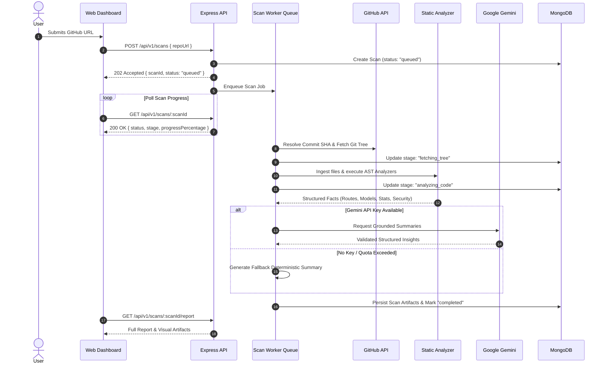

# Architecture & System Design — Repo Analyzer

## 1. High-Level Architecture

```
                  +-----------------------------------------+
                  |         Web Client (Next.js 15)         |
                  | React Flow | TanStack Query | Tailwind |
                  +--------------------+--------------------+
                                       | HTTP /api/v1
                                       v
                  +-----------------------------------------+
                  |         API Server (Express.js)         |
                  |   Job Queue  |  Validation  | Logging   |
                  +---------+--------------------+----------+
                            |                    |
         +------------------+                    +-------------------+
         |                                                           |
         v                                                           v
+------------------------+                                +------------------------+
|   MongoDB Database     |                                | Static Analysis Engine |
| Projects, Scans,       |                                | AST Parsers, TS-Morph, |
| ScanArtifacts, History |                                | Line Counters, Security|
+------------------------+                                +-----------+------------+
                                                                      |
                                                                      v
                                                          +------------------------+
                                                          | Google Gemini Provider |
                                                          | Grounded Synthesis API |
                                                          +------------------------+
```

## 2. Monorepo Organization

- **`apps/web`**: Next.js App Router application with Tailwind CSS, React Flow, Lucide icons, and TanStack Query.
- **`apps/api`**: Express.js server providing REST API under `/api/v1`, hosting the in-memory bounded queue runner, routing, and controller layers.
- **`packages/analyzer`**: Static analysis engine containing:
  - `github/`: Git tree resolver, raw file loader, and rate-limit guard.
  - `statistics/`: Language-aware line counter (blank, comment, code lines).
  - `technologies/`: Package manifest inspector, framework heuristics, and evidence builder.
  - `express/`: AST route finder, nested router mounting resolver, middleware inspector.
  - `database-models/`: Mongoose schema and model extractor.
  - `security/`: Static vulnerability and credential pattern scanner with automated redaction.
  - `graph/`: Directed graph assembler generating React Flow nodes/edges and Mermaid diagrams.
- **`packages/ai`**: Google Gemini integration using `@google/genai` or `@google/generative-ai`, with provider interfaces, strict Zod response schemas, and offline mock fallback.
- **`packages/database`**: MongoDB connection manager and Mongoose models (`Project`, `Scan`, `ScanArtifact`, `User`).
- **`packages/shared`**: Shared TypeScript types, API contracts, Zod validators, and graph schemas.

## 3. Asynchronous Scan Pipeline Lifecycle



## 4. Key Design Decisions

1. **Separation of Facts from Synthesis**: Static analyzers extract concrete AST facts (method, resolved route path, source file, line number, handlers). Gemini only synthesizes and clarifies these facts.
2. **Scan Artifact Separation**: Large data sets (folder tree, comprehensive endpoint array, graph nodes/edges) are stored in a dedicated `ScanArtifact` Mongoose collection referenced by `scanId` to ensure individual documents do not exceed MongoDB's 16MB BSON limit.
3. **Resilient AI Degradation**: The analyzer functions seamlessly in environments with no external internet or AI credentials.
4. **AST Over Regex**: Regular expressions fail on nested `app.use()`, multi-file routers, and exported controller methods. Repo Analyzer uses the TypeScript Compiler API AST parser to accurately resolve router mount hierarchies.
