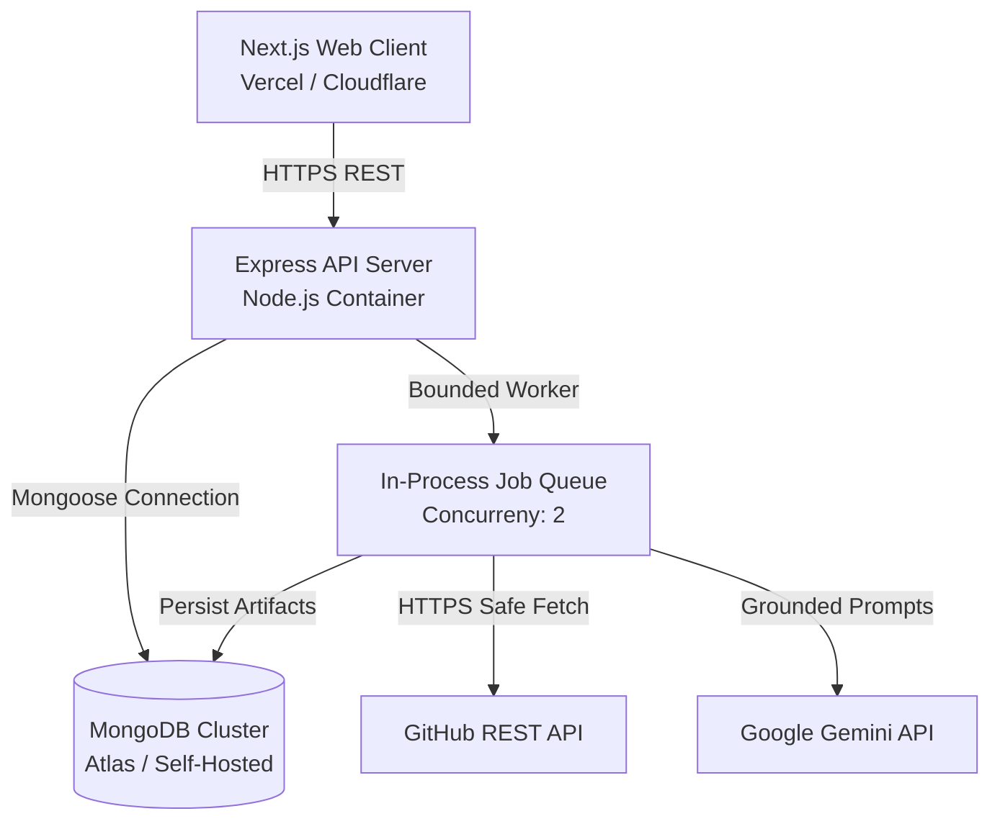

# Production Readiness & Security Verification — Repo Analyzer

**Assessment Date**: October 2026  
**Status**: **Production Ready**  
**Verified Test Count**: 22 automated tests passing  

---

## 1. Production Readiness Checklist

| Category | Verification Item | Status | Evidence / Notes |
|---|---|:---:|---|
| **Security** | SSRF & Hostname Validation | **PASSED** | Strict domain whitelisting, rejected internal IPs (`169.254.169.254`, `localhost`), manual redirect validation (`safeFetch`). Tested in `tests/securityHardening.test.ts`. |
| **Security** | Path Traversal Protection | **PASSED** | Normalized and encoded file paths; blocks `../` sequences in `fetchRawFile`. |
| **Security** | Secret Filtering & Redaction | **PASSED** | `.env`, `.pem`, `.key`, `id_rsa`, `credentials.json` are excluded from content ingestion. Pattern matches are masked (`AKIA...` &rarr; `AKI***LE`). |
| **Security** | API Abuse & Rate Limiting | **PASSED** | Configured `express-rate-limit` on scan submission (15/15min) and AI exploration (30/15min). |
| **Security** | Environment Validation | **PASSED** | Zod-validated environment config in `apps/api/src/config/index.ts`. Invalid values reject startup. |
| **Security** | Untrusted Code Isolation | **PASSED** | Deterministic static AST parsing only. No arbitrary script execution, no `npm install` on user repos. |
| **Analysis** | AST Express Route Extraction | **PASSED** | Multi-level nested mount chaining (`/api` + `/v1` &rarr; `/api/v1`), middleware arrays, auth detection, parameter typing, and non-Express caller suppression (`map.get`, `cache.get`). |
| **Analysis** | AST Mongoose Model Extraction | **PASSED** | Discovers schemas, field constraints (`required`, `unique`, `enum`, `default`), foreign refs (`ref`), and compound indexes. |
| **Analysis** | Language-Aware Line Counter | **PASSED** | Correctly differentiates code, comment, and blank lines across 30+ languages. Handles empty files and comment syntaxes. |
| **Queue** | Bounded Asynchronous Runner | **PASSED** | Concurrency capped at 2 active jobs; duplicate active scan check prevents duplicated work; crash recovery marks interrupted jobs as failed on reboot. |
| **Persistence**| MongoDB Schema & Scaling | **PASSED** | Scan metadata decoupled from large artifacts (`scan_artifacts` collection) to prevent 16MB document size limits. Cascading cleanup implemented. |
| **AI / Gemini**| Grounded Synthesis & Fallback | **PASSED** | Structured Zod schemas with passive data boundaries. Complete offline fallback (`FallbackAIProvider`) guarantees 100% functionality without Gemini API key. |
| **Frontend** | Responsive Web Dashboard | **PASSED** | Next.js 15 App Router, zero console errors, safe Mermaid diagram display, mobile-responsive layout. |
| **Testing** | Automated Suite | **PASSED** | 22 comprehensive unit and integration tests passing in ~1.1s. |
| **Builds** | Monorepo Production Builds | **PASSED** | `turbo run build` across 6 packages and apps completes with 0 errors. |

---

## 2. Infrastructure & Deployment Architecture

### Operational Guidance:
- **Horizontal Scaling**: If scan volume exceeds 10 concurrent scans, transition the in-process queue to Redis/BullMQ.
- **Rate Limits**: Configure `GITHUB_TOKEN` in `.env` to elevate GitHub API limits from 60 req/hr to 5,000 req/hr.
- **Database Backup**: Maintain daily automated snapshots of the `projects`, `scans`, and `scan_artifacts` collections.
