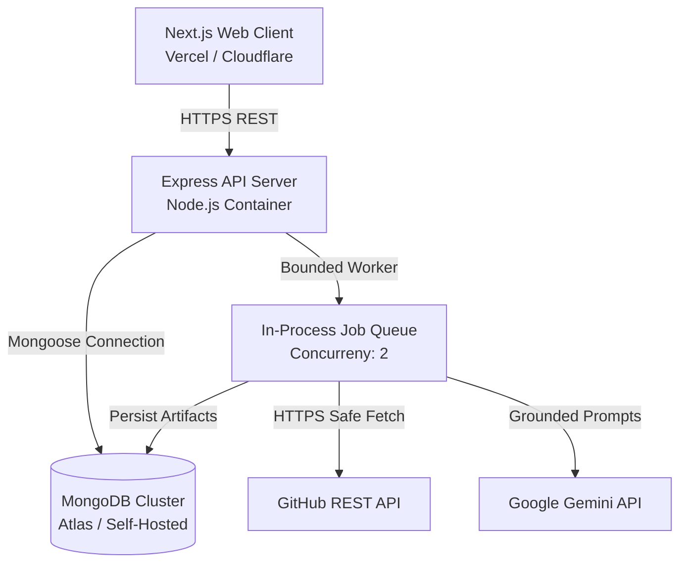

# Production Readiness & Security Verification — Repo Analyzer

**Assessment Date**: October 31, 2026  
**Status**: **Production Ready & Hardened**  
**Verified Test Count**: 28 automated tests passing  

---

## 1. Production Readiness Checklist

| Category | Verification Item | Status | Evidence / Notes |
|---|---|:---:|---|
| **Security** | SSRF & Hostname Validation | **PASSED** | Strict domain whitelisting, rejected internal IPs (`169.254.169.254`, `localhost`), standard port 443 enforcement, credential stripping, manual redirect inspection (`safeFetch`). Tested in `tests/securityHardening.test.ts`. |
| **Security** | Path Traversal Protection | **PASSED** | Normalized, decoded, and encoded file paths; blocks `../`, `%2e%2e`, and null bytes `\0` in `fetchRawFile`. |
| **Security** | Secret Filtering & Redaction | **PASSED** | `.env*`, `.npmrc`, `.pypirc`, `.netrc`, `.pem`, `.key`, `id_rsa`, `id_dsa`, `id_ecdsa`, `credentials.json`, `keystore` excluded from ingestion. Pattern matches (`AKIA...`, `sk-...`, `AIza...`, `xoxb-...`, Mongo URIs) masked via `redactSecret`. |
| **Security** | HTTP Security Headers | **PASSED** | Helmet integrated: `X-Content-Type-Options: nosniff`, `X-Frame-Options: SAMEORIGIN`, `Strict-Transport-Security`, `app.disable('x-powered-by')`. |
| **Security** | API Abuse & Rate Limiting | **PASSED** | Multi-tier rate limiting: 15/15min on scan creation, 30/15min on AI explain, 300/15min globally. 1MB body limit & 30s request timeout. |
| **Security** | Gemini Key Protection | **PASSED** | API key transmitted via `x-goog-api-key` HTTP header rather than query string; questions bounded to 500 chars. |
| **Security** | Untrusted Code Isolation | **PASSED** | Deterministic static AST parsing only. No arbitrary script execution, no `npm install` on user repos. |
| **Analysis** | AST Express Route Extraction | **PASSED** | Multi-level nested mount chaining (`/api` + `/v1` &rarr; `/api/v1`), middleware arrays, auth detection, parameter typing, and non-Express caller suppression (`map.get`, `cache.get`). |
| **Analysis** | AST Mongoose Model Extraction | **PASSED** | Discovers schemas, field constraints (`required`, `unique`, `enum`, `default`), foreign refs (`ref`), and compound indexes. |
| **Analysis** | Language-Aware Line Counter | **PASSED** | Correctly differentiates code, comment, and blank lines across 30+ languages. Handles empty files and mixed comment syntaxes. |
| **Queue** | Bounded Asynchronous Runner | **PASSED** | Concurrency capped at 2 active jobs; 5-minute timeout guard prevents slot starvation; startup crash recovery marks interrupted jobs as failed on reboot. |
| **Persistence**| MongoDB Schema & Scaling | **PASSED** | Granular artifact storage (`scan_artifacts` collection) prevents 16MB document size limits. Unique compound indexes & cascading cleanup implemented. |
| **AI / Gemini**| Grounded Synthesis & Fallback | **PASSED** | Structured Zod schemas with passive data boundaries. Complete offline fallback (`FallbackAIProvider`) guarantees 100% functionality without Gemini API key. |
| **Frontend** | Responsive Web Dashboard | **PASSED** | Next.js 15 App Router, zero console errors, safe Mermaid diagram display, exponential backoff polling, mobile-responsive layout. |
| **Testing** | Automated Suite | **PASSED** | 28 comprehensive unit and integration tests passing in ~1.2s. |
| **Builds** | Monorepo Production Builds | **PASSED** | `turbo run build` across all 6 packages and apps completes with 0 errors. |

---

## 2. Infrastructure & Deployment Architecture

### Operational Guidance:
- **Horizontal Scaling**: If scan volume exceeds 10 concurrent scans, transition the in-process queue to Redis/BullMQ.
- **Rate Limits**: Configure `GITHUB_TOKEN` in `.env` to elevate GitHub API limits from 60 req/hr to 5,000 req/hr.
- **Database Backup**: Maintain daily automated snapshots of the `projects`, `scans`, and `scan_artifacts` collections.
